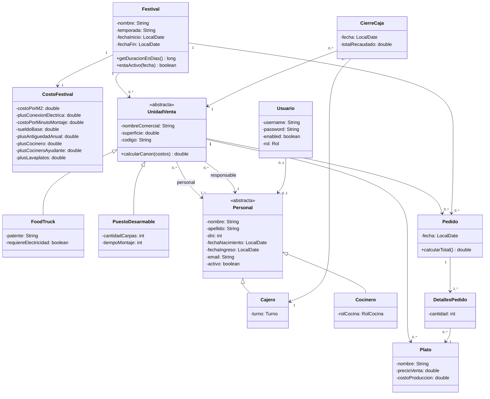

# TP Grupal OO2 2026 - Sistema de Gestión "Epicentro Gourmet"

Trabajo práctico grupal de Orientación a Objetos II (UNLa).

- **Hito 1 (Hibernate):** carpeta [`hito1/`](hito1/) y tag `hito1` (tal cual se entregó).
- **Hito 2 (Spring Boot):** raíz de este repositorio (proyecto Maven).

## Grupo

**Grupo 10**

| Nombre y Apellido | Usuario GitHub |
|---|---|
| Juan Ignacio Avalle | JuanAvalle77 |
| Santiago Agarzúa | SantiagoCode06 |
| Franco Joaquín Luzardo | FJLuzardo |
| Federico Acosta Rosales | FederAcosta |

## Stack

Java 17+ · Spring Boot 3.3 (Web, Data JPA, Security, Validation, Mail) · Thymeleaf · Maven · MySQL 8 · Lombok · ModelMapper · OpenPDF

## Cómo correr la aplicación

### 1) Requisitos
- JDK 17 o superior (sirve el JDK 21 que trae Eclipse).
- MySQL 8 corriendo.
- No hace falta instalar Maven: el proyecto trae el wrapper (`mvnw`).

### 2) Crear la base de datos
```sql
CREATE DATABASE epicentro_gourmet_h2 CHARACTER SET utf8mb4 COLLATE utf8mb4_unicode_ci;
```

### 3) Variables de entorno
Las credenciales **no** se escriben en el código (`application.yml` las lee del entorno):

| Variable | Obligatoria | Descripción |
|---|---|---|
| `DB_USERNAME` | sí | usuario de MySQL (ej: `root`) |
| `DB_PASSWORD` | sí | contraseña de MySQL |
| `DB_URL` | no | por defecto `jdbc:mysql://localhost:3306/epicentro_gourmet_h2?serverTimezone=America/Argentina/Buenos_Aires` |
| `MAIL_USERNAME` / `MAIL_PASSWORD` | no | cuenta SMTP (Gmail con contraseña de aplicación). Si no se definen, los mails solo se muestran en la consola. |

> No usar el nombre `USERNAME`: en Windows ya existe y es el usuario del sistema.

PowerShell (para la sesión actual):
```powershell
$env:DB_USERNAME="root"; $env:DB_PASSWORD="tu_password"
```
En Eclipse/STS: *Run Configurations → Environment*. En IntelliJ: *Edit Configurations → Environment variables*.

### 4) Primera ejecución (crea las tablas)
```bash
./mvnw spring-boot:run          # en Windows PowerShell: .\mvnw.cmd spring-boot:run
```
Si `JAVA_HOME` no está definida, apuntarla al JDK. Cuando termine de arrancar (`Started EpicentrogourmetApplication`), detener la app con `Ctrl+C`.

### 5) Cargar los datos de prueba
Con MySQL Workbench (abrir y ejecutar `sql/datos_prueba.sql` sobre `epicentro_gourmet_h2`) o por consola:
```bash
mysql -u root -p --default-character-set=utf8mb4 epicentro_gourmet_h2 < sql/datos_prueba.sql
```
El script se puede volver a ejecutar cuando quieran: borra los datos y los recarga. Las fechas son relativas a hoy (siempre hay un festival activo).

### 6) Usar la aplicación
Volver a correr `./mvnw spring-boot:run` y entrar a http://localhost:8080

| Usuario | Contraseña | Rol |
|---|---|---|
| `admin` | `admin123` | Administrador |
| `juan.perez@epicentro.com` | `resp123` | Responsable de *El Fueguito* (festival activo) |
| `rocio.fernandez@epicentro.com` | `resp123` | Responsable de *La Empanada Andante* |
| `pedro.gomez@epicentro.com` | `resp123` | Responsable de *La Carpa de Pedro* |
| `lucia.gomez@epicentro.com` | `emp123` | Empleada (cajera) |
| `marcos.diaz@epicentro.com` | `emp123` | Empleado (cocina) |
| `valentina.ortiz@epicentro.com` | `emp123` | Empleada (lavaplatos, trabajó en 2 festivales) |

> **Lombok en Eclipse:** si ven errores de `getX()/setX()` inexistentes, hay que instalar Lombok en el IDE (`java -jar lombok.jar`, que está en `~/.m2/repository/org/projectlombok/lombok/`). Alternativa: correr siempre con `mvnw` desde la terminal.

## Estructura del proyecto

```
src/main/java/com/unla/epicentrogourmet/
  entities/       entidades JPA (modelo del diagrama)
  enums/          Rol, RolCocina, Turno
  repositories/   interfaces JpaRepository
  services/       interfaz + implementation/ (logica de negocio)
  controllers/    controladores MVC (devuelven vistas Thymeleaf)
  dtos/           DTOs de reportes (no persisten)
  helpers/        ViewRouteHelper (rutas y vistas)
  configuration/  seguridad, ModelMapper
src/main/resources/templates/   vistas (layout.html con navbar por rol)
sql/datos_prueba.sql            datos de prueba
hito1/                          proyecto del Hito 1
```

La seguridad separa tres zonas: `/admin/**` (ADMIN), `/responsable/**` (RESPONSABLE) y `/empleado/**` (EMPLEADO). Las contraseñas se guardan con BCrypt. El login redirige al panel del rol.

## Diagrama de clases (iterado en el Hito 2)

Fuente editable del Hito 1: [`diagrama/oo2UML.dia`](diagrama/oo2UML.dia). Cambios del Hito 2 respecto al Hito 1:
- `Cocinero` pasa a tener `rolCocina` (cocinero, ayudante, lavaplatos) en vez de `especialidad`; `Cajero` tiene `turno` (mañana/noche) y cobra antigüedad.
- Nueva `CostoFestival`: encapsula los costos del festival (costo por m², plus eléctrico, costo por minuto de montaje, sueldo base, plus por antigüedad y por categoría). Nada hardcodeado.
- `Personal` suma `email` (es su usuario), `activo` (baja lógica) y se relaciona *muchos a muchos* con `UnidadVenta` (así un empleado puede haber trabajado en varios festivales).
- Nuevas `Usuario` (con `Rol`) y `CierreCaja`.
- Los reportes (`ReporteVentaDTO`, `ReporteMayoresCanonDTO`, `PlatoDTO`) son DTOs que no persisten.



## Casos de uso implementados y responsables

El estado y el link al Pull Request de cada caso de uso se completan acá a medida que se mergean.

| # | Caso de uso | Rol | Responsable | Rama | PR | Estado |
|---|---|---|---|---|---|---|
| Base | Proyecto Maven, entidades, login por roles, inicio con festivales, script SQL | todos | Juan Avalle | `CUBaseProyectoJuanAvalle` | _pendiente_ | en curso |
| 1 | Ver festivales | Admin | Franco Luzardo | `CUVerFestivalesFrancoLuzardo` | | pendiente |
| 2 | Ver unidades de venta de un festival | Admin | Franco Luzardo | `CUVerUnidadesFestivalFrancoLuzardo` | | pendiente |
| 3 | Ranking de unidades por recaudación | Admin | Franco Luzardo | `CURankingUnidadesFrancoLuzardo` | | pendiente |
| 4 | Unidades con mayor canon (`ReporteMayoresCanonDTO`) | Admin | Franco Luzardo | `CUMayorCanonFrancoLuzardo` | | pendiente |
| 5 | Registro de Unidad de Venta con su Responsable (crea usuario) | Público | Santiago Agarzúa | `CURegistroUnidadSantiagoAgarzua` | | pendiente |
| 6 | Alta, baja lógica, modificación y reactivación de empleados + **mail** | Responsable | Juan Avalle | `CUABMEmpleadosJuanAvalle` | | pendiente |
| 7 | Alta de platos | Responsable | Santiago Agarzúa | `CUAltaPlatosSantiagoAgarzua` | | pendiente |
| 8 | Filtros de empleados por uno o varios atributos (solo activos) | Responsable | Juan Avalle | `CUFiltrosEmpleadosJuanAvalle` | | pendiente |
| 9 | Cálculo de canon de una unidad | Responsable | Juan Avalle | `CUCalculoCanonJuanAvalle` | | pendiente |
| 10 | Liquidación de haberes | Responsable | Juan Avalle | `CULiquidacionHaberesJuanAvalle` | | pendiente |
| 11 | Reporte de recaudación de un festival (`ReporteVentaDTO`) | Responsable | Federico Acosta | `CUReporteRecaudacionFedericoAcosta` | | pendiente |
| 12 | Rentabilidad neta de una unidad en un festival | Responsable | Federico Acosta | `CURentabilidadNetaFedericoAcosta` | | pendiente |
| 13 | Rentabilidad neta entre dos fechas | Responsable | Federico Acosta | `CURentabilidadFechasFedericoAcosta` | | pendiente |
| 14 | Plato estrella (`PlatoDTO`) | Responsable | Santiago Agarzúa | `CUPlatoEstrellaSantiagoAgarzua` | | pendiente |
| 15 | Ver mi información (festivales y unidades en las que trabajé) | Empleado | Franco Luzardo | `CUMiInformacionFrancoLuzardo` | | pendiente |
| 16 | Descargar recibo de sueldo en **PDF** | Empleado | Federico Acosta | `CUReciboSueldoFedericoAcosta` | | pendiente |
| 17 | Ver en qué festival activo y unidad trabajo hoy | Empleado | Santiago Agarzúa | `CUDondeTrabajoHoySantiagoAgarzua` | | pendiente |
| 18 | Cerrar caja (cajero) | Empleado | Federico Acosta | `CUCerrarCajaFedericoAcosta` | | pendiente |

**Mínimos por grupo:** 1 envío de mail (CU 6) · 1 DTO de reporte (CU 4, 11, 14) · 1 PDF (CU 16).

**Validaciones de carga (2 por integrante):**

| Integrante | Validaciones |
|---|---|
| Juan Avalle | personal mayor de edad · email con formato válido y único |
| Santiago Agarzúa | código de unidad único y con formato válido · superficie mayor a 0 |
| Franco Luzardo | período del festival válido (fin posterior al inicio) · nombre de usuario único |
| Federico Acosta | un pedido solo puede cargarse con la fecha del día · precio de venta mayor al costo de producción del plato |

**Dependencias entre casos de uso:** los CU 9 (canon) y 10 (haberes) los usan los CU 4, 12, 13 y 16. Se mergean primero; mientras tanto el resto puede avanzar con los datos de prueba.

## Cómo trabajar (ramas y Pull Requests)

Cada caso de uso entra a `main` **mediante Pull Request**. No se pushea directo a `main`.

```bash
git checkout main && git pull
git checkout -b CUAltaPlatosSantiagoAgarzua      # CU<Funcionalidad><Responsable>
# ... desarrollar y probar el caso de uso ...
git add . && git commit -m "CU Alta de platos: entidad, repositorio, servicio, controlador y vista"
git push -u origin CUAltaPlatosSantiagoAgarzua
gh pr create --base main --fill                   # o desde la web de GitHub
```

Reglas:
1. En la descripción del PR detallar lo realizado (entidades, repositorios, servicios, controladores, vistas) y cómo probarlo.
2. Pegar el link del PR en la columna *PR* de la tabla de arriba.
3. Cada caso de uso agrega su link en el `navbar` de `layout.html` (dentro del bloque de su rol) y en el panel del rol.
4. Un compañero revisa el PR antes de mergear. Evitar tocar archivos de otros casos de uso para no generar conflictos.
5. Nada hardcodeado: los valores de negocio (sueldo base, canon, plus) salen de `CostoFestival`.
6. Credenciales solo por variables de entorno; nunca commitear contraseñas.
